# Shoku

<p align="center">
  
</p>

<p align="center"><b>A calm, local-first food log for Android.</b><br>
Log a meal in a few taps, describe it to Claude or photograph it, scan packs, cook batches, plan the week
and see how it's going. Your data lives on your phone.</p>

<p align="center"><a href="docs/media/shoku-demo.mp4">Watch the 30-second video (MP4)</a></p>

## What Shoku is

Shoku is a native Android app (Kotlin, Jetpack Compose) for logging what you eat against a daily goal
for calories, protein and fibre. It is built around home cooking: generic foods with household units,
dishes and the batches you cook from them, what's in the fridge and the pantry, and a week of meal
templates.

It is **local-first**. Everything is stored on the phone in a Room database, and the app works fully
offline. There is no account, no analytics and no ads. AI and cloud sync are optional, and both are
yours: AI uses your own Claude API key, and sync talks to a backend you host.

## Features

**Logging**
- Today shows calories left, eaten and planned bars for calories, protein and fibre (carbs and fat one
  tap away) and a card per meal. Swipe between days.
- Add searches your foods, dishes and batches, and understands amounts: "200 g curd", "2 eggs".
- "Usual for lunch" logs what you normally have with one tap, and "Copy yesterday's dinner" repeats a
  whole meal.
- Log ahead as Planned, then tick items off as you eat them. Notes on any entry ("restaurant, half portion").
- Generic foods ("Any brand") with typical values and units like bowl, cup, tbsp or medium; branded
  products sit under their generic.

**AI** (optional, with your own Claude key)
- Describe a meal in words, or dictate it: "2 rotis, a katori of rajma and a cucumber salad".
- Read a nutrition label from a photo, or estimate a plate from up to four photos.
- Turn a recipe sentence into batch ingredients; meal ideas and a week plan from your stock and habits.
- Every AI answer opens a review first: untick, fix amounts, then log or save as a draft.

**Scanning**
- Scan a barcode from Add, Library or Stock. Known packs log straight away; new ones are looked up on
  Open Food Facts, which covers many Indian brands. Packs without nutrition go to the label photo.

**Library and batches**
- Foods, dishes (recipes) and batches (one real cook, with servings and the cooked weight).
- Log a batch by servings or grams. Today shows what's in the fridge and how much is left; a batch that's
  used up finishes itself.
- Edit a food and optionally recalculate past entries and batches that used it.

**Plan and supplements**
- Meal templates per weekday, with a slot for "whatever sabzi or dal is in the fridge". Today offers
  the day's plan while meals are empty.
- Supplements with daily, weekly or monthly schedules, reminders, stock and the day each runs out.
  Shown as information only, not medical advice.

**Stock**
- Fridge, freezer, pantry, spices and supplements. Stock is a ledger: eating, cooking and taking
  supplements use it up by themselves. Spices are just have, low or out.
- A to-buy list from what's running low, plus what next week's plan needs.

**Insights**
- A month at a glance: daily averages, days logged, protein met, calories on target, daily bars and a
  calendar heatmap. Weight with a 7-day average, and supplement streaks.

**Search everything**
- One box for what's at home, your log (notes included), foods, dishes, batches, the plan,
  supplements, food databases and online products.

**Widget and more**
- A home-screen and lock-screen widget with calories left and Add, Describe and Scan buttons.
- Meal reminders only when a meal is still empty, `shoku://` links and app shortcuts, light and dark
  themes, an optional Health Connect export of eaten food and weight, and a backup ZIP export.

## Screenshots

Rendered from the real app with made-up demo data (see [docs/SCREENSHOTS.md](docs/SCREENSHOTS.md)).

| | | | |
|:-:|:-:|:-:|:-:|
| 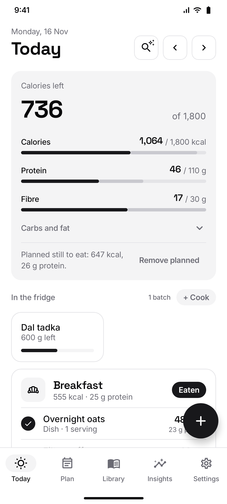 | 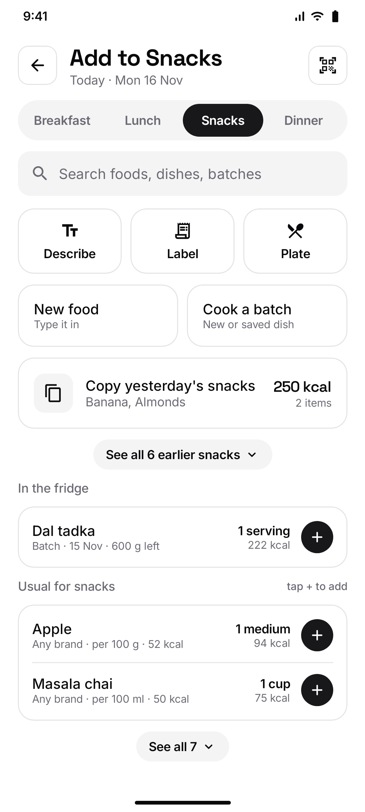 | 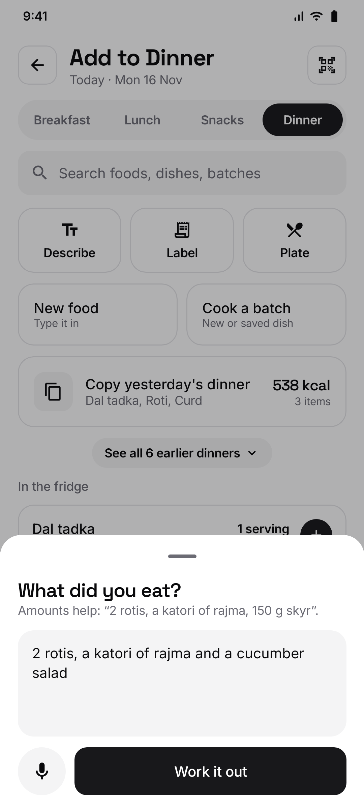 | 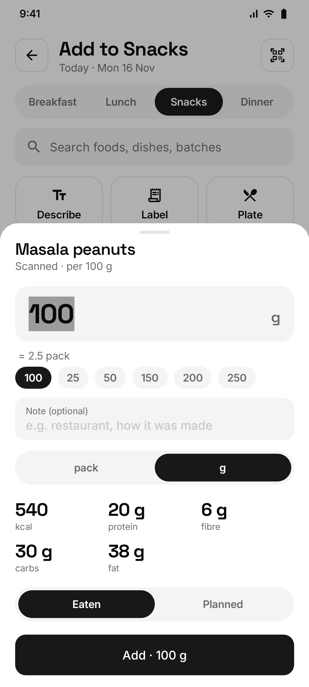 |
| Today | Add | Describe | Scanned pack |
| 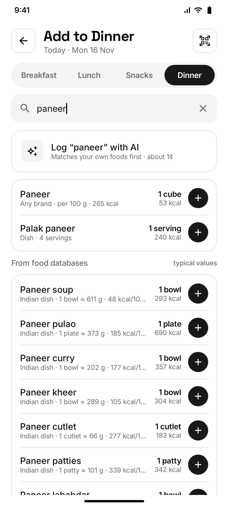 | 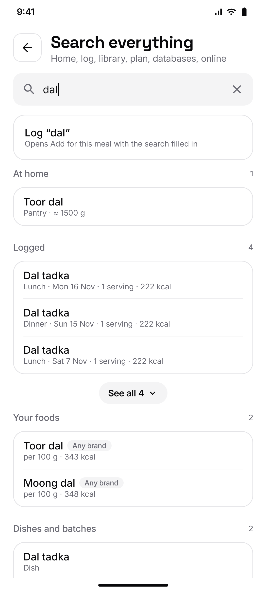 | 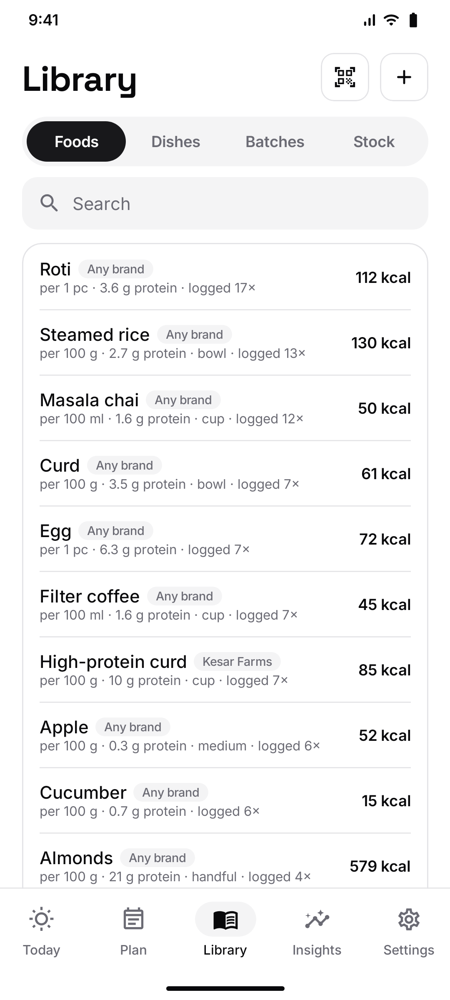 | 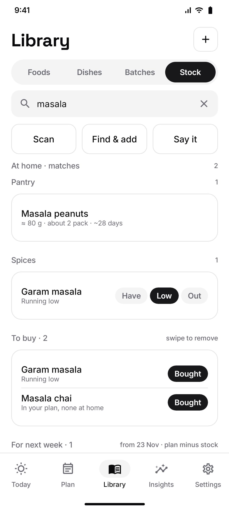 |
| Search in Add | Search everything | Library | Stock search |
| 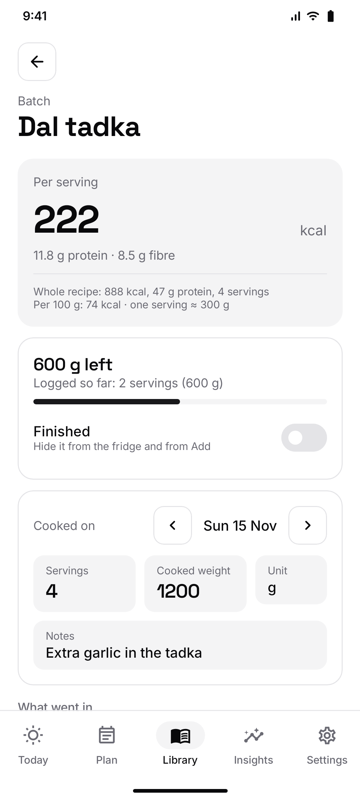 | 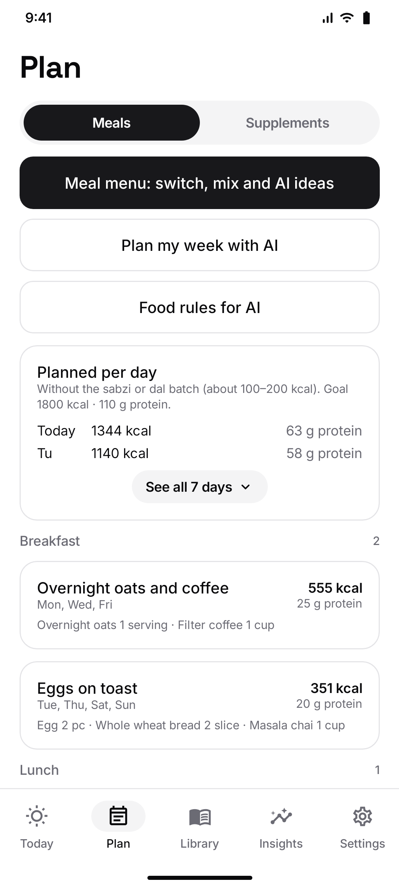 | 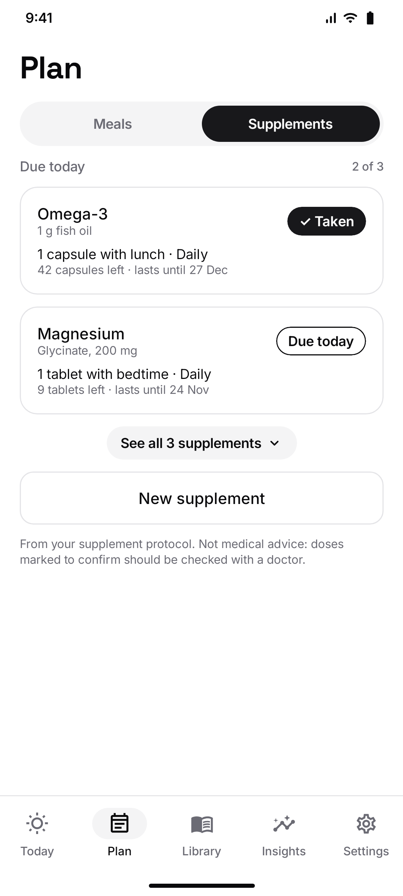 | 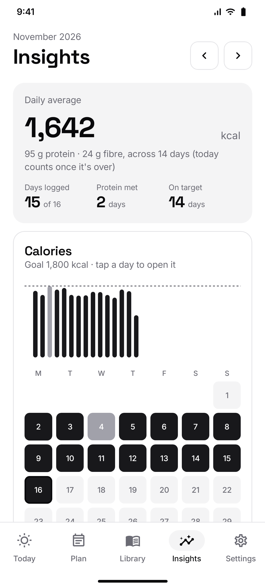 |
| Batch | Plan | Supplements | Insights |
| 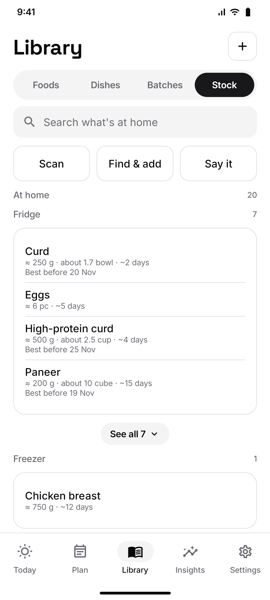 | 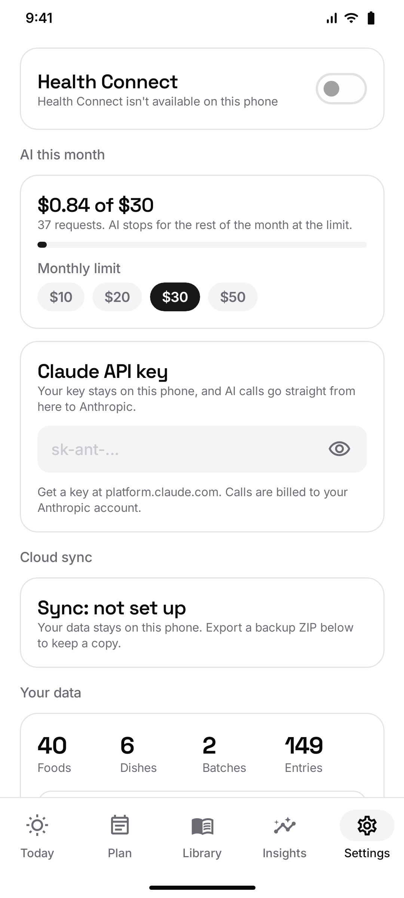 | 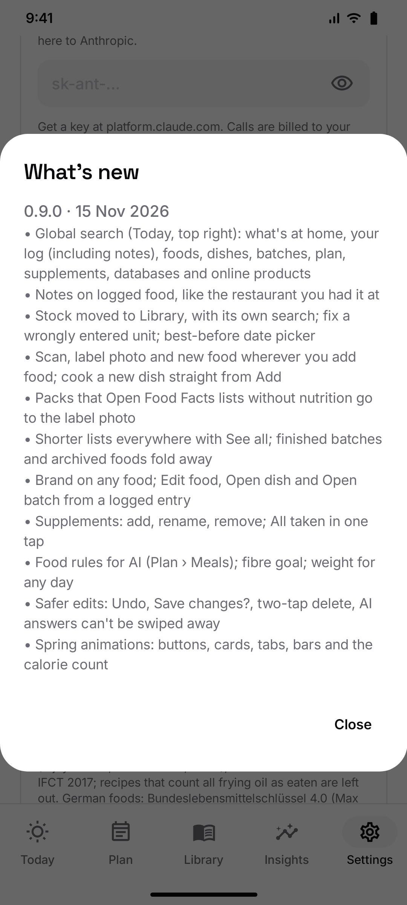 | 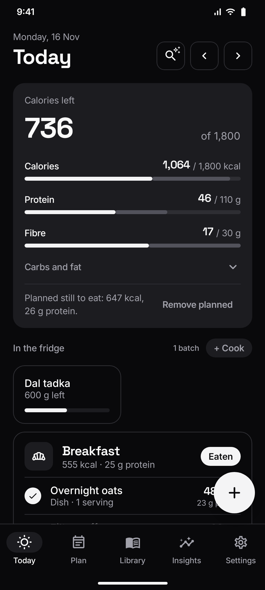 |
| Stock | Your Claude key | What's new | Dark theme |

## How AI works

AI is off until you add a key. In **Settings → AI this month → Claude API key**, paste a key from
[platform.claude.com](https://platform.claude.com). From then on:

- Calls go **straight from the phone to Anthropic** through the official Anthropic Java SDK. Nothing
  passes through a Shoku server.
- The key is stored encrypted with a key held in the Android Keystore, so a cloud backup of the app's
  data can't be used to read it.
- Spending is priced per call and kept on the phone, with a **monthly cap** ($30 by default, adjustable).
  AI stops for the rest of the month at the cap. Household units are filled in through the Message
  Batches API at half price.
- AI requests carry what you asked about (text or photos) and your food library, so the answer can match
  your own foods first.

Without a key, everything except the AI buttons works as usual. Models, prompts and the backend mode are
described in [docs/AI.md](docs/AI.md).

## Optional sync and backend

`backend/` is a small Zoho Catalyst function (Node 22) that you can host yourself. It provides
two-way sync (last write wins, soft deletes; runs when the app opens and closes, and every 12 hours) and
can also answer the AI routes with a key kept on the server. Builds without it simply show "Sync: not
set up". Setup steps are in [docs/AI.md](docs/AI.md#backend-mode-self-hosting); the app reads the URL
and a shared key from `android/local.properties`, which is never committed.

## Food data

- **Open Food Facts** is used live: barcode lookups and product search go to openfoodfacts.org, and a
  product you log is saved in your library, so the same barcode never needs the network again.
- **Not included in this repository**, for licence reasons: the Indian Nutrient Databank (INDB), the
  German Bundeslebensmittelschlüssel (BLS) and an offline copy of Open Food Facts India. The app looks
  for them in `android/app/src/main/assets/` as `reference_indb.csv`, `reference_bls.csv` and
  `off_india.csv`.
- **The app works without them.** Search then covers your own foods and Open Food Facts, and barcodes
  are looked up online.

To build them yourself, `tools/` has:

- `tools/off_india.py` streams Open Food Facts' daily export
  (`en.openfoodfacts.org.products.csv.gz`, about 1.5 GB) into `off_india.csv`: products sold in India
  or with an Indian (890) barcode, keeping only those whose calories roughly match their macros
  (about 15,000 products, 1 MB). It also accepts JSON pages from their search API.
- `tools/indb_fried_oil.py` corrects INDB's deep-fried recipes, which count all the frying oil as
  eaten, using typical absorbed oil by food type and only INDB's own numbers.

There is no script yet for the base INDB or BLS conversion. Both files share one simple format, so
they're easy to make from the official downloads:

```
code,name,kcal,protein,carbs,fat,fibre,serving_label,serving_g,aliases
```

Values are per 100 g; `serving_label` and `serving_g` describe a typical portion ("bowl", 200), and
`aliases` holds other names for search.

## Build from source

You need Android Studio (or a JDK 21 and the Android SDK with platform 37). The app targets Android 16
(`targetSdk 36`) and runs on **Android 12 and newer** (`minSdk 31`).

```sh
cd android
./gradlew :app:assembleDebug          # app/build/outputs/apk/debug/
./gradlew :app:testDebugUnitTest      # unit tests (no network; see below)
./gradlew :app:assembleRelease        # about 5 MB
```

The release build is about 5 MB because R8 shrinks it, and it is signed with the debug key, so it
installs on your own phone but isn't meant for a store. Use your own signing config to publish it.

Optional settings go in `android/local.properties`: `shoku.syncUrl` and `shoku.syncKey` for your own
backend. Screenshots and the video are made in code, without a device: see
[docs/SCREENSHOTS.md](docs/SCREENSHOTS.md).

## Privacy

- Your log, library, plan and stock stay on your phone, in the app's private storage.
- The app talks to the network only for: Open Food Facts (a barcode, or the words you search for),
  Anthropic (only when you use an AI feature with your own key), and your own backend if you set one up.
  It sends a generic user agent and no personal details to Open Food Facts.
- No account, no analytics, no ads, no tracking.
- The Health Connect export is off unless you turn it on; it writes eaten food and weight to Health
  Connect on the phone and reads nothing back.
- Export a backup ZIP from Settings at any time.
- The test suite can't reach the network: every JVM test runs with a switch that disables sync, AI, Open
  Food Facts and Health Connect, and a tripwire fails the run on any connection attempt.

Shoku is a personal logging tool, not medical advice. Nutrition values are estimates.

## Tech stack

- **App:** Kotlin, Jetpack Compose with Material 3, Room (versioned schemas with migrations), WorkManager,
  kotlinx.serialization, the Anthropic Java SDK, Google's code scanner, Health Connect. No DI framework.
- **Build:** Gradle with the Android Gradle Plugin 9 and a version catalog.
- **Backend (optional):** a Zoho Catalyst Advanced I/O function in Node 22, with the Catalyst Data Store.
- **Tests:** JUnit, Robolectric with native graphics, and Roborazzi for screenshots.
- **Video:** [Remotion](https://www.remotion.dev) (TypeScript) in `promo/`.

## Credits

- [Open Food Facts](https://world.openfoodfacts.org): product data under the Open Database License
  (ODbL); contents under the Database Contents License.
- INDB: Indian Nutrient Databank (Vijayakumar, Jaacks et al., 2024), based on ICMR-NIN IFCT 2017.
- BLS 4.0: Bundeslebensmittelschlüssel, Max Rubner-Institut.
- Fonts: [Inter](https://rsms.me/inter/) and [Space Grotesk](https://github.com/floriankarsten/space-grotesk),
  SIL Open Font License.

## Licence

[MIT](LICENSE), © Shoku contributors.
